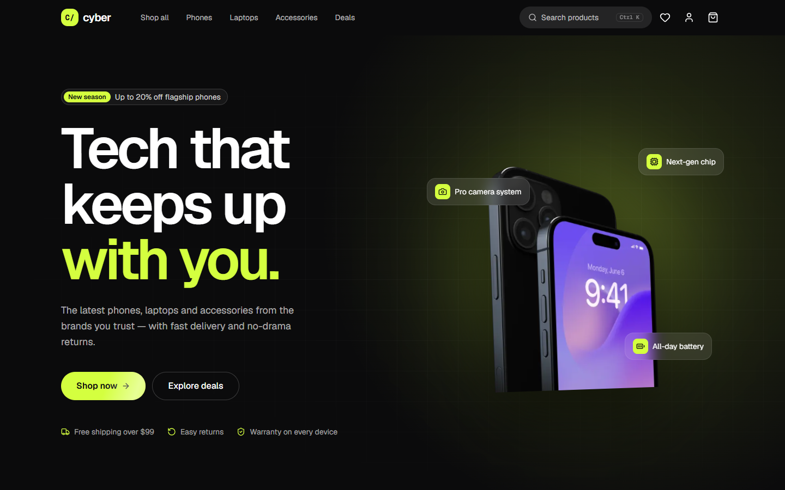
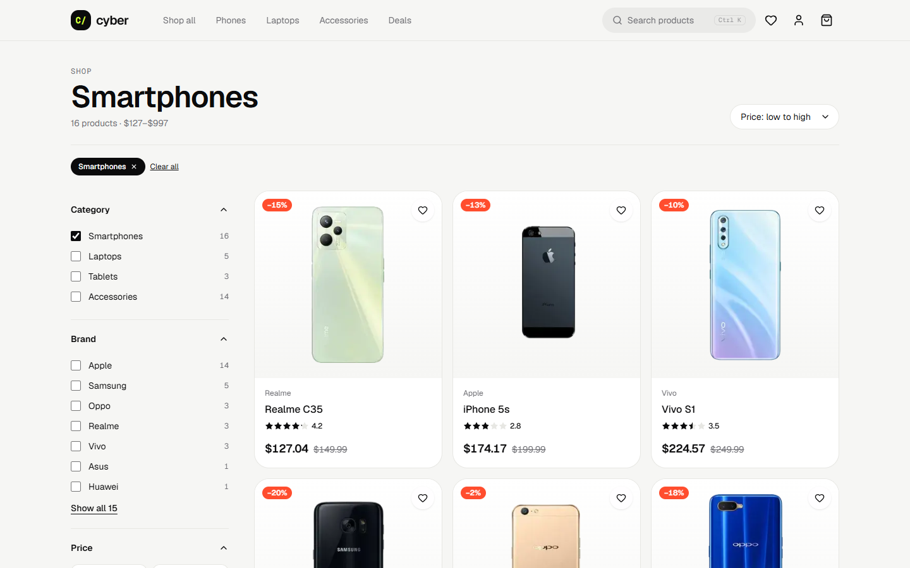
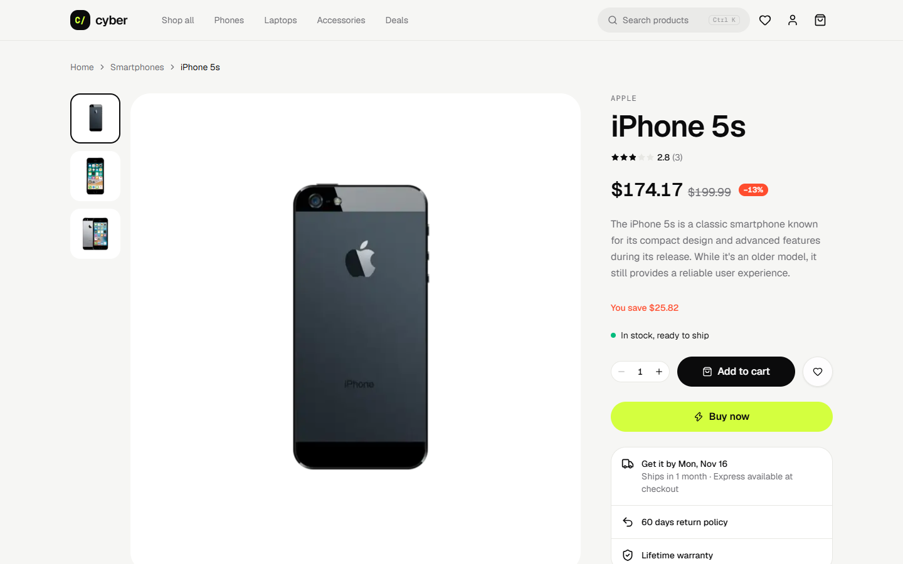
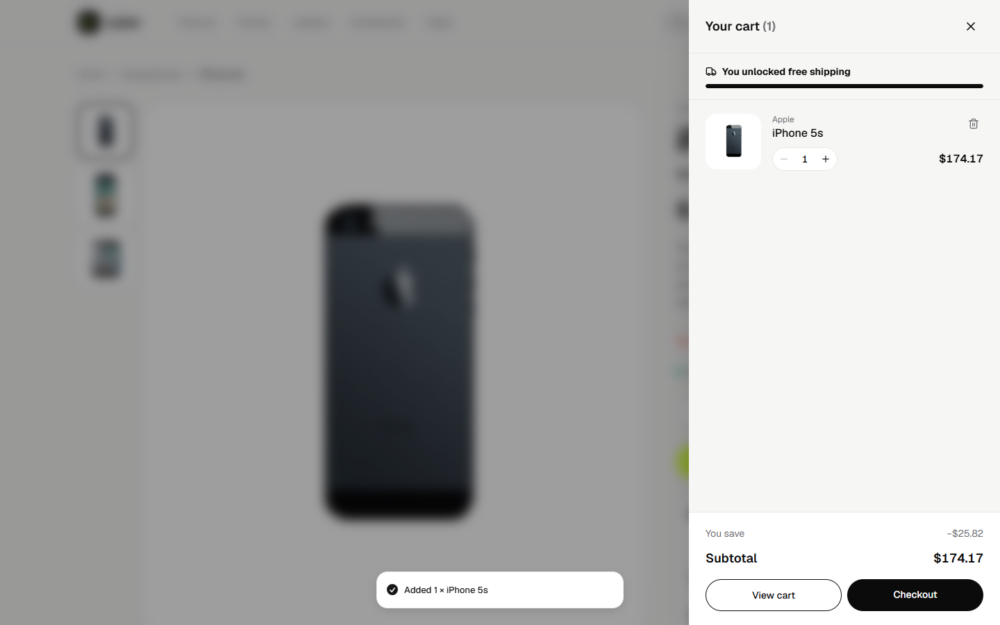
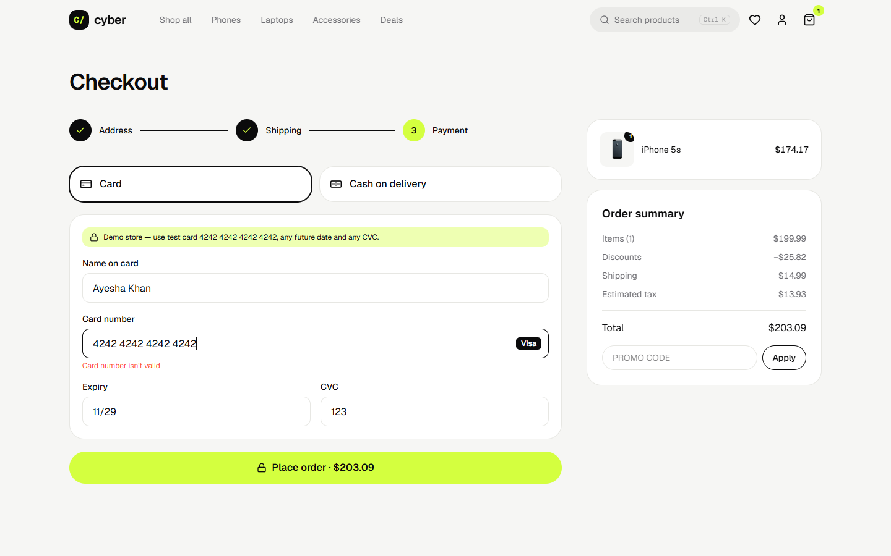
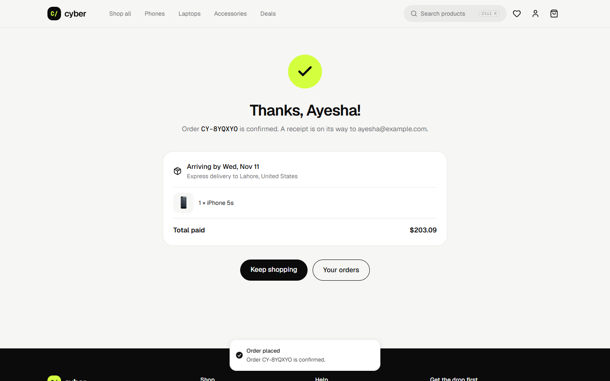

# Cyber — Electronics Storefront

[](https://github.com/itx-Champion/cyber-e-commerce/actions/workflows/ci.yml)

**Live demo:** [cyber-e-commerce-blond.vercel.app](https://cyber-e-commerce-blond.vercel.app) · **Stack:** Next.js 16 · React 19 · TypeScript · Tailwind CSS 4 · Motion · Zustand · Zod · Vitest



A production-style e-commerce storefront for phones, laptops, tablets and accessories. Shoppers can browse, filter, search, save favourites, and check out as a guest or with an account. The full flow runs end to end: product discovery → cart → address → shipping → payment → order confirmation → order history.

> Demo store: product data comes from the public [DummyJSON](https://dummyjson.com) API. No real orders or payments are processed — use the test card `4242 4242 4242 4242`.

## Features

| Area | What it does |
|---|---|
| **Home** | Animated hero with a pointer-driven 3D tilt, brand marquee, category bento grid, tabbed product rails (trending, top rated, deals, new), a deal of the day with a live countdown, promo banners |
| **Catalog** | Filter by category, brand, price and rating, plus an in-stock toggle and six sort orders. Filters live in the URL, so every view is shareable and survives refresh. Active-filter chips and a bottom-sheet filter panel on mobile |
| **Search** | `Ctrl K` command-style search with prefix matching, keyboard navigation and a full-results page |
| **Product page** | Image gallery with hover zoom, live stock status, a delivery estimate derived from the supplier's shipping time, quantity selector, add-to-cart / buy-now, wishlist, specs and reviews tabs, related products. JSON-LD structured data powers rich search results |
| **Cart** | Slide-over drawer and full cart page, free-shipping progress bar, quantity limits based on stock, promo codes (`CYBER10`, `WELCOME5`) |
| **Checkout** | Three-step flow (address → shipping → payment) with Zod validation and inline errors, three delivery speeds with date estimates, card validation (Luhn check, expiry, CVC, brand detection) or cash on delivery, guest checkout |
| **Account** | Sign in or register, saved address, order history; cart, wishlist and account persist across visits |
| **Quality** | Static generation of all product pages with hourly revalidation (`"use cache"` + `cacheLife`), `next/image` optimisation, skip link and keyboard support, reduced-motion support, security headers, sitemap, robots and an OG image |

## Screenshots

| Catalog with filters | Product page |
|---|---|
|  |  |
| **Cart drawer** | **Checkout** |
|  |  |
| **Order confirmation** | **Mobile** |
|  |  |

## Architecture

```
src/
├─ app/                      # Routes: home, products, products/[id], cart, checkout, account, wishlist
├─ components/
│  ├─ home/                  # Hero, bento, product tabs, deal of the day
│  ├─ catalog/               # Filters, sorting, URL-synced state
│  ├─ product/               # Gallery, buy box, details tabs
│  └─ …                      # Header, cart drawer, search, product card, order summary
└─ lib/
   ├─ products.ts            # Server-only catalog fetchers with schema validation and caching
   ├─ catalog-filter.ts      # Pure search / filter / sort logic (unit tested)
   ├─ pricing.ts             # Totals, shipping, tax, promos, delivery dates (unit tested)
   ├─ checkout.ts            # Zod schemas, Luhn and expiry validation (unit tested)
   └─ store.ts               # Zustand stores for cart, wishlist and account, persisted to localStorage
```

**Decisions worth noting**

- **Server-rendered catalog, client-side filtering.** Product pages are pre-rendered at build time and revalidated hourly. The catalog page receives the full electronics range once and filters instantly in the browser, so filters feel immediate with no loading spinners.
- **Validated data at the boundary.** API responses are parsed with Zod before they reach components, so a malformed product can't crash a page.
- **One source of truth for money.** Cart, drawer, checkout and tests share `computeTotals`, so the totals agree to the cent everywhere.
- **Hydration-safe persistence.** Stores rehydrate after first paint, and counts render only once hydrated, so server HTML and client state never disagree.

## Run locally

```bash
npm install
npm run dev        # http://localhost:3000
npm test           # unit tests (Vitest)
npm run typecheck
npm run build
```

No environment variables are required.

---

Previous version: the original Create React App build lives in the git history (commit `7e6d872`).

Built by **Muhammad Ahmad**, AI Engineer & Full-Stack Developer. [GitHub](https://github.com/itx-Champion)
